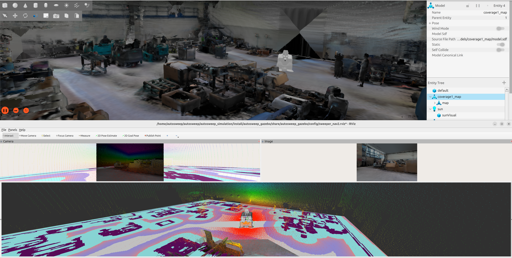
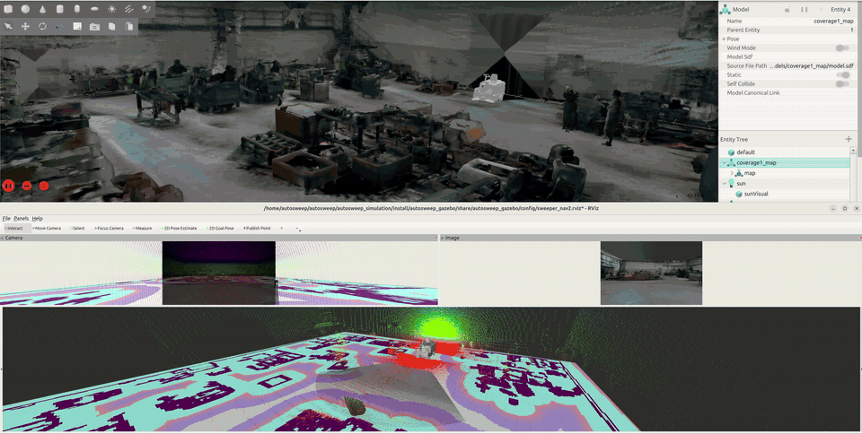

# Simulazione AutoSweep per Eureka



Simulazione ROS 2 Jazzy e Gazebo Harmonic della spazzatrice autonoma Eureka.

Il milestone attuale comprende il modello dei sensori, una trasmissione a triciclo
provvisoria, `ros2_control`, l'odometria ground truth di Gazebo e la teleoperazione
temporanea da tastiera.

## Componenti implementati

- Due LiDAR Hesai JT128 simulati.
- Una camera RGB-D Intel RealSense D456 simulata.
- Una ruota anteriore sterzante e motrice provvisoria.
- Due ruote posteriori passive.
- `joint_state_broadcaster` e `tricycle_controller`.
- `/odom` ground truth (posa reale del robot in Gazebo, plugin
  `OdometryPublisher`) e TF `odom -> base_footprint`. L'odometria delle ruote
  resta disponibile su `/tricycle_controller/odom`, ma non è usata.
- `/odom_path` con la cronologia dell'odometria visualizzata come linea in RViz.
- Interfaccia `/cmd_vel` condivisa basata su `geometry_msgs/msg/TwistStamped`.
- Teleoperazione temporanea da tastiera.
- Mondo `coverage1_world.sdf` con la mappa statica `coverage1_map` ricostruita
  da `finer_mapping`.

## Compilazione

Eseguire la compilazione dalla radice del repository:

```bash
source /opt/ros/jazzy/setup.bash

colcon build \
  --base-paths autosweep_description autosweep_gazebo \
  --symlink-install \
  --packages-select autosweep_description autosweep_gazebo \
  --cmake-args -DPython3_EXECUTABLE=/usr/bin/python3
```

## Avvio della simulazione



Il video completo in qualità piena è disponibile in
[images/nav2_goto_demo.mp4](images/nav2_goto_demo.mp4).

Nel primo terminale, dalla radice del repository:

```bash
source /opt/ros/jazzy/setup.bash
source install/setup.bash

ros2 launch autosweep_gazebo simulation_launcher.py use_sim_time:=true
```

Questo avvia Gazebo, il bridge ROS/Gazebo, `robot_state_publisher`, entrambi i
controller `ros2_control`, il convertitore da odometria a path, Nav2 e RViz.
Per avviare solo la simulazione senza Nav2 aggiungere `nav2:=false`.

RViz usa `odom` come frame fisso e visualizza `/odom_path` con il display
`Path`. Il convertitore aggiunge una posa ogni 0,05 m oppure ogni 0,05 rad e
conserva al massimo 5000 pose, evitando di accumulare tutti i messaggi
odometrici pubblicati mentre il robot è fermo.

## Navigazione go-to (Nav2)

Navigazione minima verso un obiettivo, basata solo sulla mappa statica e
sull'odometria ground truth di Gazebo.

Dipendenze:

```bash
sudo apt install ros-jazzy-navigation2
```

Con `nav2:=true` (predefinito), dopo l'avvio del `tricycle_controller` il
launcher avvia:

- `map_server`, che carica `autosweep_gazebo/maps/coverage1_map.yaml` (griglia
  `.pgm` generata da `finer_mapping/outputs/coverage1/nav2/`, nello stesso frame
  del mondo Gazebo);
- una TF statica identità `map -> odom` (il frame della mappa coincide con
  quello del mondo Gazebo, in cui è espressa l'odometria ground truth);
- `planner_server` (Smac Hybrid-A*, Reeds-Shepp), `controller_server` (MPPI con
  modello Ackermann), `behavior_server` e `bt_navigator`, gestiti da
  `lifecycle_manager_navigation`.

I parametri sono in `autosweep_gazebo/config/nav2_params.yaml`: raggio minimo di
curvatura 0,85 m, footprint rettangolare e `/cmd_vel` di tipo `TwistStamped`.
Mappa e parametri si possono sostituire con `map:=<file>.yaml` e
`nav2_params:=<file>.yaml`.

Il robot viene creato in `(0.5, 0.5)` con yaw `0`: in `(0, 0)` il suo footprint
si sovrappone a celle occupate della mappa e il planner rifiuta la partenza.
La posa si cambia con `spawn_x:=`, `spawn_y:=` e `spawn_yaw:=` (radianti) e
deve cadere in una zona libera della mappa.

In RViz (frame fisso `map`) usare **2D Goal Pose** per inviare un obiettivo.
Il robot non ruota sul posto: per obiettivi con forti cambi di direzione esegue
curve ampie o brevi manovre in retromarcia.

Limitazioni:

- non c'è localizzazione: la posa è il ground truth del simulatore, quindi la
  navigazione non risente di errori odometrici che sul robot reale ci sarebbero;
- le costmap contengono solo la mappa statica, quindi gli ostacoli non presenti
  nella mappa non vengono evitati.

Per aggiornare la mappa copiare `coverage1_map.pgm` e `coverage1_map.yaml` da
`finer_mapping/outputs/coverage1/nav2/` in `autosweep_gazebo/maps/`. Nel file
`.yaml` usare `free_thresh: 0.196`: con 0.25 le celle sconosciute (grigio 205)
vengono caricate come libere.

La ricostruzione `coverage1_map` non è allineata alla gravità (pavimento inclinato
di circa 2.3°): la posa dell'`<include>` in `worlds/coverage1_world.sdf`, ripetuta
in `scripts/map_mesh_publisher.py` per RViz, la porta in piano. Se la mesh cambia
la posa va ricalcolata.

## Mondo di simulazione

Il mondo predefinito è `autosweep_gazebo/worlds/coverage1_world.sdf`, che include
il modello `autosweep_gazebo/models/coverage1_map` (mesh visuale, texture e mesh
di collisione). Il launcher aggiunge `models/` a `GZ_SIM_RESOURCE_PATH`; un altro
mondo si seleziona con l'argomento `world:=<file>.sdf`.

Per aggiornare la mappa, copiare `coverage1_map/` e `coverage1_world.sdf` da
`finer_mapping/outputs/coverage1/gazebo/` e, nel file del mondo:

- rinominare il mondo in `sweeper_world` (nome usato dal launcher per lo spawn);
- sostituire l'URI assoluto `file:///...` con `model://coverage1_map`.

Poi ricompilare.

## Controllo da tastiera

### Da Gazebo

Oltre al terminale, il robot si può comandare dalla GUI di Gazebo tramite il
pannello **Teleop**: selezionare `/cmd_vel`, abilitare la tastiera e usare **WASD**.

### Da terminale

Eseguire il nodo per la tastiera in un secondo terminale. Il terminale deve
rimanere attivo perché il nodo legge direttamente i tasti premuti.

```bash
source /opt/ros/jazzy/setup.bash
source install/setup.bash

ros2 run teleop_twist_keyboard teleop_twist_keyboard --ros-args \
  -p stamped:=true \
  -p frame_id:=base_footprint \
  -p use_sim_time:=true \
  -p speed:=0.10 \
  -p turn:=0.05
```

| Tasto | Comando |
| --- | --- |
| `u` | Avanti e a sinistra |
| `i` | Avanti |
| `o` | Avanti e a destra |
| `,` | Retromarcia |
| `k` o Spazio | Arresto |

Se non arrivano nuovi comandi, il controller arresta il veicolo dopo 500 ms. Premere
`Ctrl+C` per terminare il nodo della tastiera; prima di uscire pubblica un ultimo
comando con velocità zero.

La convenzione delle coordinate ROS usa `x` in avanti, `y` verso sinistra e `z`
verso l'alto. Un valore positivo di `angular.z` fa curvare a sinistra.

## Principali interfacce ROS

| Topic | Tipo | Scopo |
| --- | --- | --- |
| `/cmd_vel` | `geometry_msgs/msg/TwistStamped` | Comando della base mobile |
| `/odom` | `nav_msgs/msg/Odometry` | Odometria ground truth di Gazebo |
| `/odom_path` | `nav_msgs/msg/Path` | Cronologia delle pose per RViz |
| `/joint_states` | `sensor_msgs/msg/JointState` | Feedback dei giunti mobili |
| `/clock` | `rosgraph_msgs/msg/Clock` | Orologio della simulazione Gazebo |

## Limitazioni attuali (TODO)

- Geometria della trasmissione, masse, inerzie, limiti di sterzata, attrito e
  parametri di contatto sono provvisori e richiederanno un aggiornamento una volta
  disponibili i parametri del prototipo.
- Le ruote e i giunti di sterzata sono articolati fisicamente, ma le rispettive
  visuali mobili non sono ancora state separate dalla mesh monolitica del telaio.
- I sensori di prossimità verranno aggiunti quando saranno disponibili le loro
  specifiche.
- I lidar (`/lidar_front/scan`, `/lidar_rear/scan`) sono simulati e pubblicati
  in ROS, ma la navigazione Nav2 non li usa: non c'è né localizzazione
  né SLAM, e la posa del robot è il ground truth del simulatore. La
  navigazione go-to è quindi limitata: sul robot reale servirà una
  localizzazione, e gli ostacoli non presenti nella mappa statica non vengono
  rilevati né evitati.


